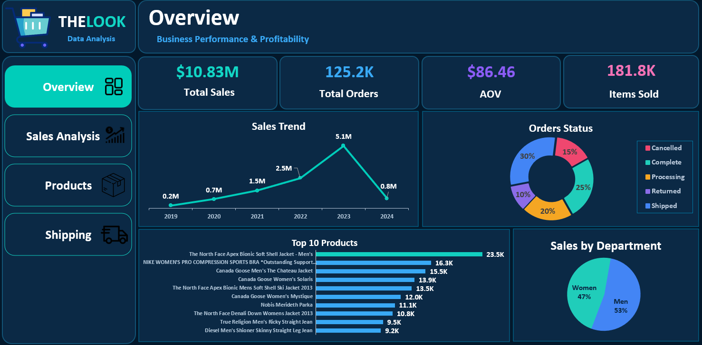
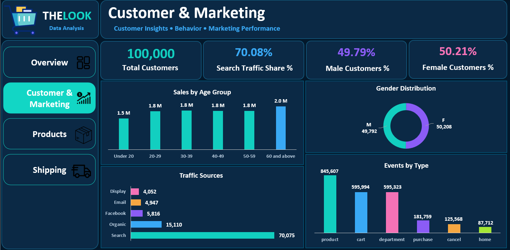
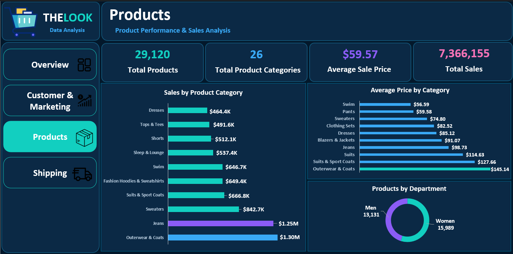
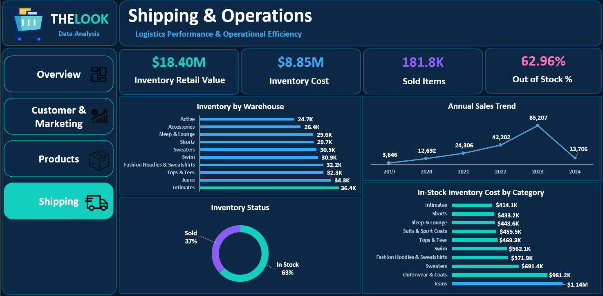

# THELOOK — Business Performance Dashboard

An interactive, multi-page Excel dashboard built to explore business performance across sales, products, customers, marketing, inventory, and shipping operations.

## Project Overview

THELOOK demonstrates how Microsoft Excel can transform business data into clear performance indicators and actionable insights. The dashboard is organized into four analytical pages.

## Dashboard Preview

### 1. Business Overview

### 2. Customer & Marketing

### 3. Product Performance

### 4. Shipping & Operations

## Dashboard Pages

1. **Business Overview** — high-level KPIs, sales trend, order status, top products, and sales by department.
2. **Customer & Marketing Analytics** — customer demographics, traffic sources, age groups, and event activity.
3. **Product Performance** — product/category sales, average prices, and product distribution by department.
4. **Shipping & Operations** — inventory indicators, inventory status, annual sales trend, and in-stock inventory cost by category.

## Tools & Techniques

- Microsoft Excel
- PivotTables and PivotCharts
- KPI tracking
- Interactive slicers and filtering
- Data analysis and visualization
- Business recommendations based on dashboard findings

## Business Questions

- How is overall sales performance changing over time?
- Which products and categories contribute most to sales?
- How do customer segments and traffic sources differ?
- What inventory patterns may require operational action?
- Where could shipping and fulfillment processes be improved?

## Key Recommendations

- Monitor core KPIs regularly and investigate unexpected changes.
- Review product/category performance before making assortment decisions.
- Validate inventory status calculations and investigate out-of-stock exposure.
- Compare customer and marketing segments to prioritize effective activities.
- Track shipping and operational indicators to identify recurring delays or bottlenecks.
- Confirm the completeness of each reporting period before interpreting period-over-period declines.

## Data Quality Notes

Before publishing conclusions, verify that KPI formulas match the underlying PivotTables and charts. In particular, reconcile the **Out of Stock** KPI with the inventory-status breakdown, and confirm whether the 2024 reporting period is complete before concluding that sales declined.

## Project Files

- [Download the Excel Dashboard Workbook (.xlsm)](Data%20Invntory.xlsm) — includes the interactive dashboard and Excel Data Model.
- [Business Recommendations](THELOOK_Business_Recommendations.docx)

## Disclaimer

This project is for portfolio and educational purposes. Business recommendations should be validated against the source data and business context before implementation.

## Author

**Peter Hany** — Computer Science student focused on Data Analysis and Business Intelligence.

- GitHub: [@peterhany041](https://github.com/peterhany041)
